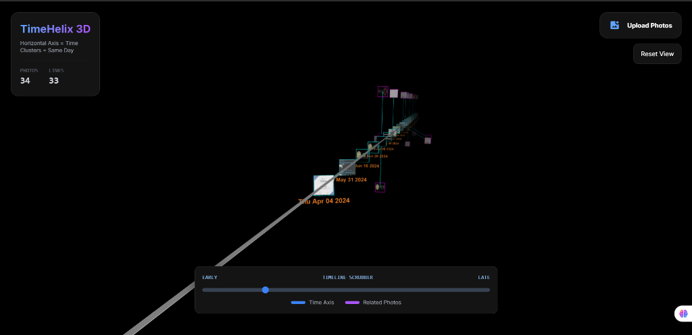
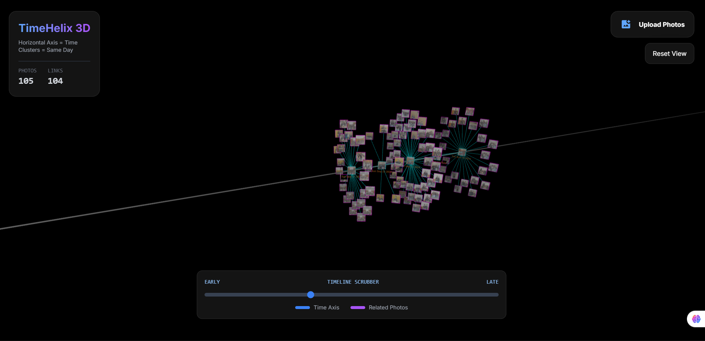

# TimeHelix 3D

TimeHelix 3D is a futuristic, 3D interactive photo visualization tool built with Next.js and Three.js. It transforms your photo library into a stunning helical timeline, allowing you to explore your memories in a completely new dimension.

## Experience the Helix

Instead of a boring 2D grid, TimeHelix arranges your photos along a chronological axis. Photos taken on the same day orbit a central "Axis Node", creating clusters of memories that look like a DNA helix of your life.



## Key Features

*   **3D Helix Visualization**: Photos are automatically grouped by date and arranged in a 3D space.
*   **Time Travel Scrubber**: Easily slide through your timeline from your earliest memories to your latest snaps.
*   **Smart Clustering**: Dates with multiple photos create orbital clusters.
*   **Interactive Lightbox**: Click any node to view the high-resolution photo in a sleek immersive view.
*   **Local Persistence**: Your graph layout is saved locally, so your timeline is ready when you return.



## Tech Stack

*   **Framework**: [Next.js](https://nextjs.org/)
*   **3D Engine**: [Three.js](https://threejs.org/)
*   **Styling**: Tailwind CSS & Glassmorphism design system

## Getting Started

1.  Clone the repository.
2.  Install dependencies:
    ```bash
    npm install
    ```
3.  Run the development server:
    ```bash
    npm run dev
    ```
4.  Open [http://localhost:3000](http://localhost:3000) with your browser.
5.  Click **Upload Photos** to select a batch of images and watch your helix build itself!

## License

MIT
